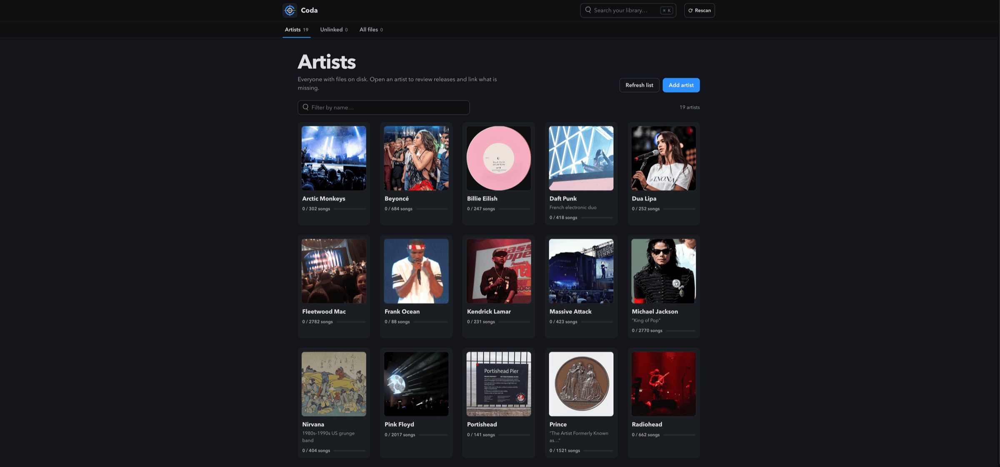
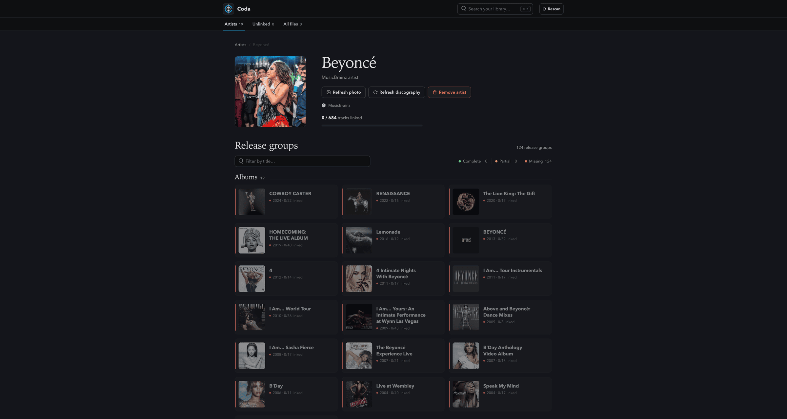
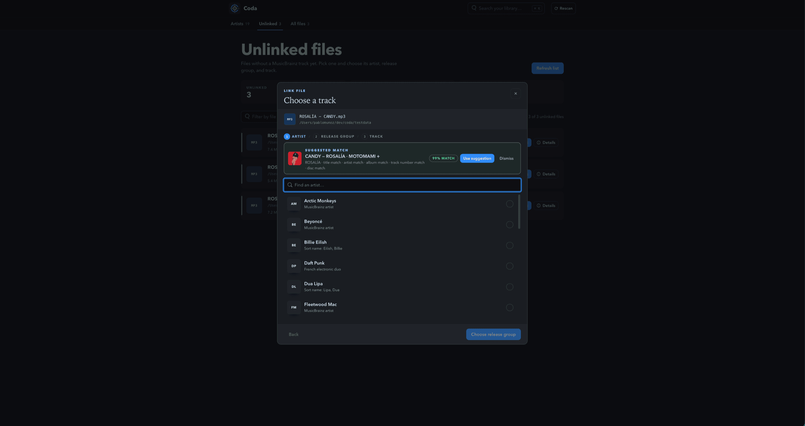

<div align="center">
  
  <h1>Coda</h1>
  <p><strong>Self-hosted music library management, done carefully.</strong></p>
  <p>Accurate metadata first. Automation only when it's trustworthy.</p>
  <p>
    <a href="https://github.com/PPabloMunoz/coda/actions/workflows/ci.yml"></a>
    <a href="https://github.com/PPabloMunoz/coda/releases"></a>
    <a href="LICENSE"></a>
    <a href="https://github.com/PPabloMunoz/coda/pkgs/container/coda"></a>
  </p>
</div>

> Early prototype (`0.x`) — expect breaking changes. Read the
> [changelog](CHANGELOG.md) and back up before upgrading
> ([how](docs/operations.md#backup-and-restore)).

## What is Coda

Coda is open-source, self-hosted music library management software. It
takes inspiration from [Lidarr](https://lidarr.audio/),
[MusicBrainz Picard](https://picard.musicbrainz.org/), and the self-hosted
music ecosystem (e.g. Navidrome) — with a narrower focus: a library and
metadata you can trust.

Coda scans audio files from your configured folders into a local SQLite
database and serves them over a small HTTP API plus an embedded web UI.
The scan auto-links files whose tags already carry a MusicBrainz
release-track ID: those get their tags rewritten, the cover embedded, and
the file moved to its canonical library path. Everything ambiguous waits
for review in the link wizard — nothing is guessed. The full read/write
contract is in [docs/library.md](docs/library.md).

<p align="center">
  
</p>
<p align="center">
  
  
</p>

## Features

- Files-only by design: one static Go binary, one SQLite file, no
  downloads, no download clients, no automation.
- MusicBrainz-backed: artists imported by MBID, discography cached
  locally, refreshes rate-limited and retried.
- Link files to release tracks: standard tags written, front cover
  embedded, files moved to `<root>/<Artist>/<Album>/`.
- Works with Navidrome and other tag-aware players
  ([docs/navidrome.md](docs/navidrome.md)).
- Cover art from Cover Art Archive, Deezer and iTunes; artist photos from
  Deezer and Wikimedia Commons. Custom JPEG/PNG/WebP uploads replace the
  cached art (release uploads re-embed into linked files); covers can also
  be removed entirely from the hero image overlay.
- Embedded web UI: plain HTML/CSS/JS, no build step, no Node.

## Install

Linux server (systemd/OpenRC — Debian/Ubuntu, Fedora/RHEL, openSUSE,
Arch, Alpine, Void):

```sh
curl -fsSL https://raw.githubusercontent.com/PPabloMunoz/coda/main/scripts/install.sh | sudo sh
```

Docker:

```sh
mkdir -p music data
PUID=$(id -u) PGID=$(id -g) docker compose up -d
```

macOS, Windows (build from source), and every other option:
[docs/install.md](docs/install.md). Releases are published for
`linux` and `darwin` on `amd64` and `arm64`; there are no prebuilt
Windows binaries.

## Quick start

1. Point Coda at your library (`roots` in `config.yaml`, or
   `CODA_ROOTS=/music:/other`; validate with `coda --check-config`) —
   [docs/configuration.md](docs/configuration.md).
2. Open `http://localhost:8687` and add artists by MusicBrainz ID.
3. Open **Link** to attach unlinked files to release tracks.

## Documentation

| | |
| --- | --- |
| [Install](docs/install.md) | installer, Docker, binary, build from source |
| [Configuration](docs/configuration.md) | config file, env vars, compose variables, data locations |
| [Library behaviour](docs/library.md) | scanning, layout, naming, formats, tags |
| [Navidrome](docs/navidrome.md) | tag compatibility and integration |
| [API](docs/api.md) | routes, parameters, envelopes, errors |
| [Operations](docs/operations.md) | backups, upgrades, logs, troubleshooting |
| [Architecture](docs/architecture.md) | how the code fits together (contributors) |

## Contributing

Issues and pull requests are welcome — see
[CONTRIBUTING.md](CONTRIBUTING.md) for scope, setup, and the PR workflow.
In short: files-only scope, small focused PRs, Conventional Commit titles,
and the full gate before pushing:

```sh
just check
```

Security issues go through [SECURITY.md](SECURITY.md). Note that Coda has
no authentication — bind it to loopback (`host: 127.0.0.1`) or run it
behind a reverse proxy, and keep it off the public internet.

## License

Copyright (C) 2026 Pablo Muñoz.

Coda is free software: you can redistribute it and/or modify it under the
terms of the GNU General Public License as published by the Free Software
Foundation, either version 3 of the License, or (at your option) any later
version. See [LICENSE](LICENSE) for the full text.
